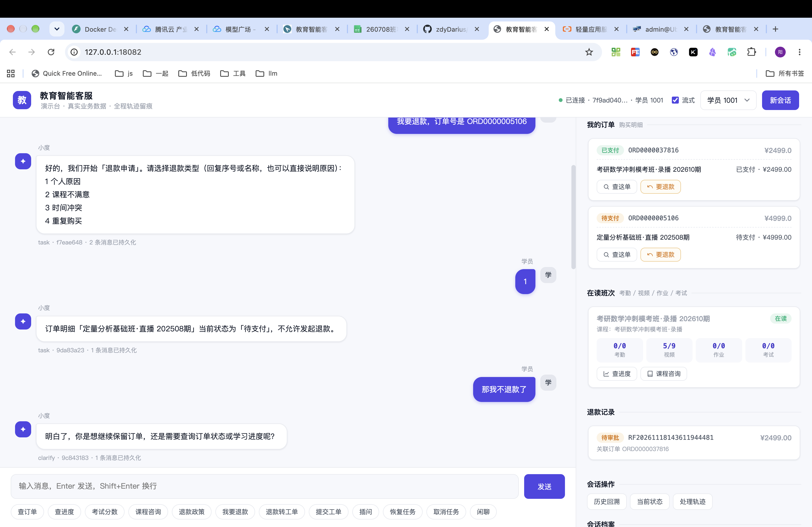
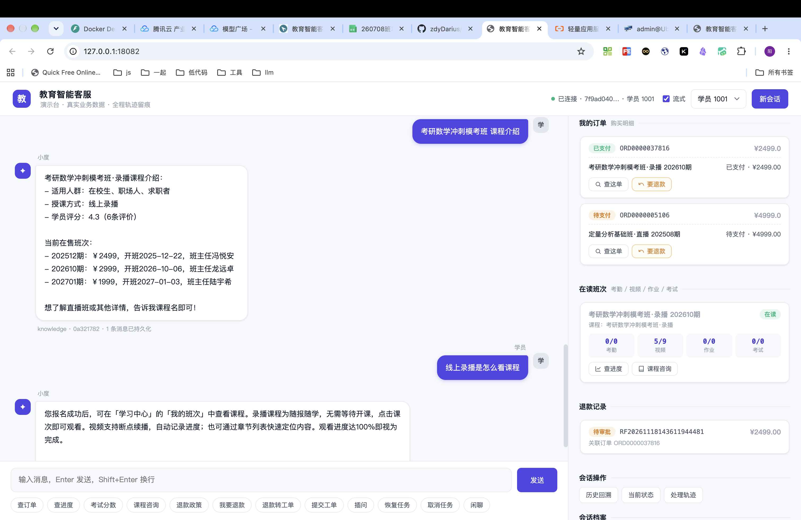
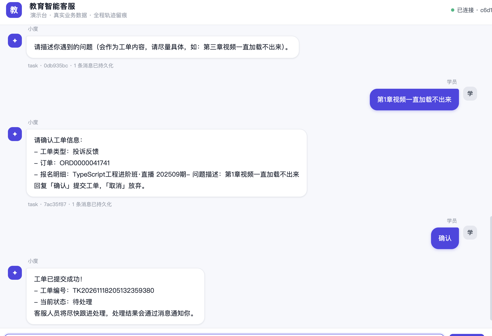

# 教育行业智能客服系统（2组_周德阳_客服_教育）

面向在线教育平台的智能客服系统：课程/班次咨询、订单查询、学习进度查询、退款申请、工单提交，支持多轮槽位收集、流程切换/恢复/取消、SSE 流式响应与全过程轨迹追踪。

## 架构总览

```text
17_CSC/
├── main.py                     # 服务入口（uvicorn）
├── init_db.py                  # 客服库自动建库建表（幂等，不触碰业务库）
├── pyproject.toml / uv.lock
├── .env.example                # 配置模板（不含密钥）
├── flow_config/user_flows.yml  # 6 个任务流程（订单查询/学习进度/退款/工单 + 退款进度/工单进度查询）
├── knowledge_base/
│   ├── faq.json                # FAQ（退款/开课/换班等固定问题）
│   └── documents/*.md          # 平台文档（BM25 RAG 语料）
├── edu_assistant/
│   ├── api/                    # FastAPI 路由、SSE、请求响应模型
│   ├── service/                # 取状态→引擎→校验→持久化（串行+防重+降级）
│   ├── engine/                 # 组件装配与主流程分流
│   ├── plan/                   # TurnPlanner（LLM 规划）+ 严格 Validator
│   ├── prompts/                # Jinja2 模板与有限历史构建
│   ├── task/
│   │   ├── command/            # 命令只改任务状态
│   │   ├── flow/               # YAML 加载 + 白名单条件解析（无 eval）
│   │   ├── flowexecutor/       # 状态机推进（死循环保护）
│   │   ├── action/             # 教育业务 Action 与注册表
│   │   └── response/           # 模板渲染（禁止 None）
│   ├── knowledge/              # 意图、Provider（FAQ/RAG/API）、回复器
│   ├── chitchat/ clarify/      # 闲聊兜底 / 可控澄清
│   ├── lifecycle/              # 任务事件模型与中文提示（审计落 task_event 表）
│   ├── domain/                 # message / state / focused object
│   ├── repository/             # SQLAlchemy 异步 ORM（5 张表）
│   ├── integrations/edu_data/  # API client + 只读订单明细适配器
│   ├── conf/ utils/            # 配置 / db / llm / http / 日志 / 异常
├── static/                     # 无构建依赖演示页
├── tests/                      # 单元/集成测试
└── docs/                       # 本文档、接口文档与验收截图（screenshots/）
```

一轮消息的处理链路：

```text
用户消息(文本/业务对象)
  → DialogueService（会话归属校验 → messageId 防重 → 会话级串行锁 → 取状态）
  → DialogueEngine
      → 文本: TurnPlanner(LLM→TurnPlan JSON) → TurnPlanValidator(严格校验)
             → task / knowledge / chitchat 三轨分流
      → 对象: 类型白名单 + 当前步骤槽位匹配 → 补槽推进 或 澄清
  → FlowExecutor（collect/action/response/end 状态机，条件跳转白名单求值）
  → ActionRunner（edu-data API / 只读明细适配器，结果写槽位）
  → 回复渲染（Jinja2，兜底非 None）
  → 持久化（消息 + 状态 + task_event + dialogue_trace）
```

## 环境要求

- Python ≥ 3.12（uv 自动管理），MySQL 8.x（客服库 + edu-data 业务库）
- edu-data 服务（FastAPI，端口默认 8000）已启动
- OpenAI 兼容 LLM 端点（默认 DashScope compatible-mode，模型 qwen-flash）

## 启动步骤

```bash
cd 17_CSC

# 1 安装依赖
uv sync

# 2 配置环境（首次使用）
cp .env.example .env
# 编辑 .env：填入 LLM_API_KEY，确认数据库连接、edu-data 地址

# 3 初始化客服库（自动建库建表，幂等）
uv run init_db.py

# 4 启动服务（默认 0.0.0.0:18082）
uv run main.py
```

启动后：

- 演示页：http://127.0.0.1:18082/
- OpenAPI 文档：http://127.0.0.1:18082/docs
- 健康检查：http://127.0.0.1:18082/health

### 启动 edu-data（业务数据服务）

在 edu-data 目录（业务库需已建库并完成数据初始化）：

```bash
uv run -m app.main    # 默认端口 8000
```

验证业务服务可用：

```bash
curl -s http://127.0.0.1:8000/health
curl -s -H "X-User-Id: 1001" http://127.0.0.1:8000/api/v1/me/student-profile
```

## 演示用户

前端演示台功能：

- **会话保持**：sessionId 保存在浏览器（按用户区分），刷新页面自动接续原会话并回放历史；点「新会话」才创建新的
- **学籍卡**（右栏）：按演示用户实时聚合档案/订单（含购买明细）/在读班次（考勤/视频/作业/考试四维进度）/退款记录；任务轨道每轮结束后自动刷新
- **场景速发**：底部磁贴一键发送典型话术（查订单/查进度/我要退款/退款转工单/插问/恢复任务等）
- **流式开关**：SSE 逐字输出与非流式一键切换；每条回复下方展示 `track · requestId · 持久化条数` 轨迹信息
- **订单/班次快捷操作**：卡片上的「查这单 / 要退款 / 查进度 / 课程咨询」直接发起对应对话

前端演示页提供四个演示用户（`X-User-Id`）：

| 用户 | 用途 | 说明 |
| --- | --- | --- |
| 1001 / 1002 / 1003 | 常规场景 | 订单/进度/工单/退款记录丰富，适合展示查询类场景 |
| 295 | **退款完整流程演示** | 3 笔订单均无占用中的退款申请，可完整走通"提交退款 → 返回退款编号" |

注意：每提交一笔退款，对应明细即产生待审批申请（edu-data 业务规则会拦截同明细重复退款）；
295 的订单被演示消耗后，可在业务库中选择其他干净订单的学员替换（查询：`order_item_status IN ('paid','completed')`
且无 `pending/approved` 退款申请的明细）。
演示用户需要在 edu-data 的 `sys_user` 表中存在且启用；会话、订单、退款、工单均按该用户隔离。
可用以下命令核对演示用户数据：

```bash
curl -s -H "X-User-Id: 295" http://127.0.0.1:8000/api/v1/orders | head
curl -s -H "X-User-Id: 295" http://127.0.0.1:8000/api/v1/me/cohorts | head
```

## 数据库说明

### 客服库（自动创建，默认 edu_cs）

`DATABASE_URL` 指向；由 `init_db.py` / 服务 lifespan 自动建表：

| 表 | 说明 |
| --- | --- |
| dialogue_session | 会话与 X-User-Id 绑定 |
| dialogue_message | 消息历史，(session_id, client_message_id) 唯一防重 |
| dialogue_state | 对话状态 JSON（含状态版本号；会话级串行锁保证并发安全） |
| task_event | 任务生命周期与关键动作审计 |
| dialogue_trace | request_id 轨迹：规划摘要/轨道/动作/耗时/错误码 |

### 业务库（edu-data，默认 edu）

- 业务查询一律走 edu-data API；**写操作只调用 API**。
- **只读订单明细适配器**：edu-data 公开 API 的订单接口不返回 `orderItemId` 与报名课程明细，而退款/工单接口必须使用 `orderItemId`。适配器使用独立配置 `EDU_READONLY_DB_URL`，仅对业务库的 `order_item`、`refund_request` 两张表执行白名单 `SELECT`（语句硬编码，无任意 SQL 入口），补偿该缺口。edu-data 后续补齐接口后可整体替换为 API 实现，不影响主流程。

## 配置说明

见 `.env.example` 内注释。关键项：

| 配置 | 说明 |
| --- | --- |
| LLM_MODEL / LLM_API_KEY / LLM_BASE_URL | OpenAI 兼容端点（默认 DashScope qwen-flash） |
| DATABASE_URL | 客服库（异步 aiomysql） |
| EDU_API_BASE_URL | edu-data 服务地址 |
| EDU_READONLY_DB_URL | 只读明细适配器（建议最小权限只读账号） |
| MAX_TEXT_LENGTH 等上限项 | 输入/历史/流程栈/暂停栈的安全上限 |

## 接口概要

| 方法 | 路径 | 说明 |
| --- | --- | --- |
| POST | /api/sessions | 创建会话（X-User-Id 绑定），返回欢迎语 |
| POST | /api/chat | 非流式聊天（sessionId + messageId + text/object） |
| POST | /api/chat/stream | SSE 流式（meta/delta/done/error） |
| GET | /api/sessions/{id}/history | 会话历史（校验归属） |
| GET | /api/sessions/{id}/state | 当前任务、暂停栈、非敏感槽位 |
| GET | /api/sessions/{id}/traces | 按 request_id 的处理轨迹 |
| GET | /api/traces/{request_id} | 单条轨迹详情（校验所属会话归属） |
| GET | /api/demo/context | 演示页学籍卡聚合（档案/订单明细/班次进度/退款，只读） |
| GET | /health / / | 健康检查 / 演示页 |

详细请求响应格式与 SSE 事件见 [api.md](./api.md)。

## 演示截图

**退款边界校验与学籍卡**：对「待支付」明细发起退款被业务规则拦截；右侧学籍卡实时展示订单明细、班次进度与退款记录。



**课程咨询与知识插问**：课程介绍基于真实课程与在售班次数据；任务中插入平台使用问题只回答知识、不中断任务。



**工单提交全流程**：描述问题 → 确认页展示类型/订单/明细/描述 → 提交成功返回工单编号（真实落库）。



## 已知边界

1. **只读明细补偿**：订单明细与退款映射来自白名单 SELECT（见上）。客服代码不写业务库。
2. **全额退款**：MVP 对所选订单明细全额退款（金额系统计算、确认页展示，不由 LLM 决定）；部分退款为增强项。
3. **演示身份**：`X-User-Id` 头标识用户，未实现登录态/权限系统；生产应替换为真实鉴权。
4. **退款审批**：退款申请创建后由 edu-data 侧人工审核，本系统不实现审批流；取消退款/工单同样属平台人工处理边界，客服仅说明并引导查询进度。
5. **LLM**：规划与知识回复依赖 OpenAI 兼容端点；规划失败、非法 JSON 均进入可控澄清或降级，不产生 500。

## 测试

```bash
uv run python -m pytest tests/unit tests/integration -q   # 单元 + 集成（不依赖真实 LLM/网络）
uv run python -m pytest tests/e2e -q                      # E2E：需 edu-data(8000) 与客服(18082) 在线，服务不可达自动跳过
```

覆盖：条件白名单求值、流程加载校验（含重复 key/use_slots）、状态序列化、防重、校验器（含多轨仲裁）、
Action 归一/选择/查询、BM25 检索、E2E 十五大验收场景（真实 edu-data + LLM）。
